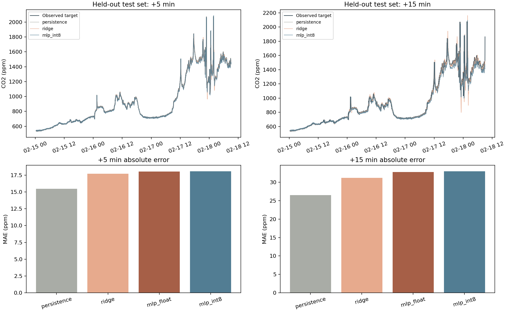
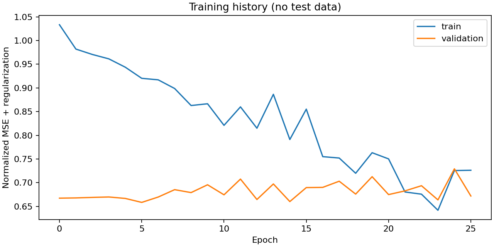

# CO₂ 小型全连接模型实验

公开办公室实测数据用于完整流程验证；不能替代本教室泛化评估。

输入：连续 20 分钟 CO₂ 单变量；原始温湿度字段保留但不进入模型。

网络：[20, 32, 16, 2]，1234 参数；int8 文件 3496 字节。

| 方法 | +5 min MAE / RMSE (ppm) | +15 min MAE / RMSE (ppm) |
|---|---|---|
| persistence | 15.46 / 43.88 | 26.50 / 64.91 |
| ridge | 17.70 / 47.67 | 31.16 / 78.63 |
| mlp_float | 18.03 / 46.10 | 32.80 / 71.72 |
| mlp_int8 | 18.06 / 46.14 | 32.95 / 71.75 |

上表为全部完整测试窗口的离线结果，包含显式标记的输入饱和诊断样本。

当前 MLP 未在两个时距均优于持续性基线；这是流程和部署初版，不能宣称普遍预测优势。

在线有效预测比例：100.00%，输入越界窗口拒绝预测。
同一有效子集的基线和模型比较见 metrics.json 的 accepted_window_comparison。

量化校准：551 条训练窗口；另加 4 条配置范围锚点（仅校准，不训练、不作实测标签）。
配置量化范围：{'co2_ppm': [350, 5000]}；超出训练分布的预测准确度尚未验证。

完整数据划分及清洗记录见 data_audit.json，阈值识别与量化差异见 metrics.json。

int8 输入越界会在离线评估中显式计数；在线入口拒绝越界，不能将饱和预测当作有效结果。
该模型仍需本教室至少两周实测重新训练。板端资源和时延只可引用 SHA256 与本模型一致的实测报告；历史报告不能沿用到新模型。
