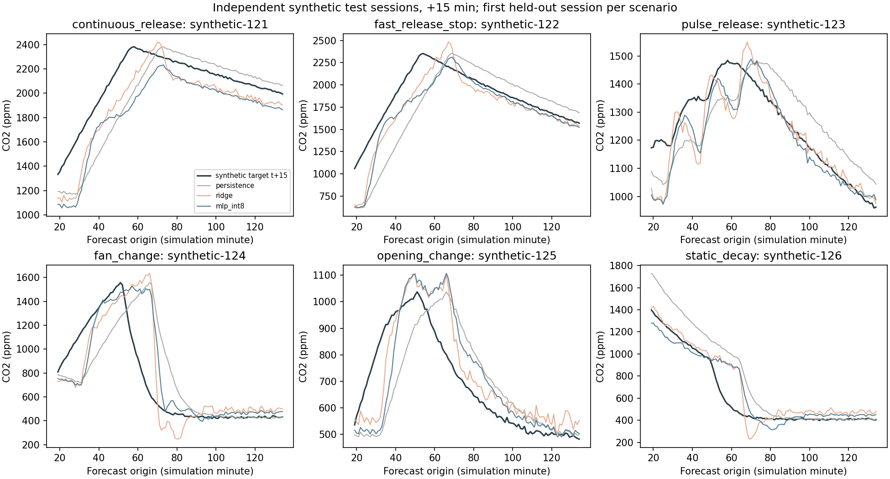
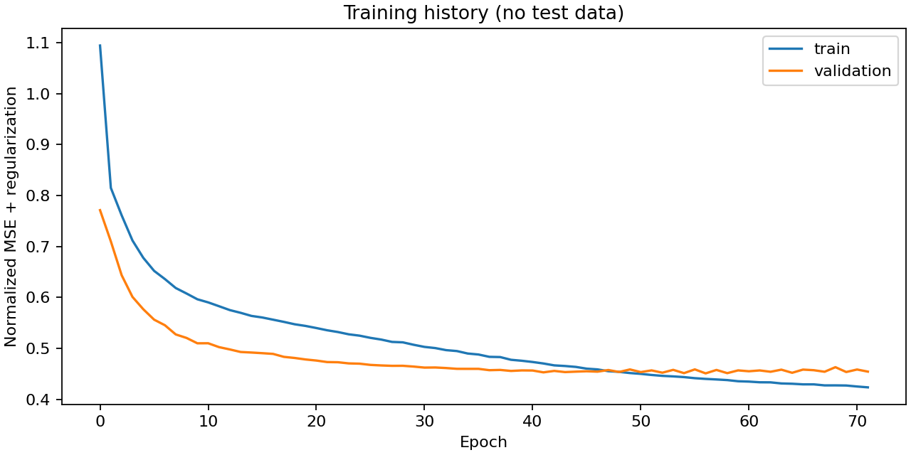

# 快速上升箱体候选模型

本实验使用明确标记为 `synthetic_chamber` 的单区质量守恒合成数据，不是箱体、传感器或教室实测。
研究时距为 +5/+15 分钟；本候选独立保存，未替换运行固件中的模型。

## 数据与模型

150 个独立合成场次，每场 150 分钟；22,500 条一分钟记录。人工日期只用于隔离场次，不代表实际采集时间。
90 / 30 / 30 场按完整人工日期先划分为训练 / 验证 / 测试，再分别构造窗口。没有同场次或重叠片段跨集合。
网络 [60, 32, 16, 2]，2514 参数；int8 4776 B。
实际训练 72 轮，最佳验证第 57 轮；仅训练集标准化与 584 条量化校准。

生成方程、参数和许可见 [数据说明](../../../data/rapid-rise/SOURCE.md)，每场参数见 [场次配置](../../../data/rapid-rise/sessions.json)。

## 冻结测试结果

快速上升子集定义：历史最近 5 分钟增加至少 100 ppm，判定只读取输入历史，不读取未来目标。
有效子集排除 int8 输入越界；全量含越界饱和诊断。各方法在同一子集比较。

### 全量测试（3480 窗口；越界 21）

| 方法 | +5 MAE / RMSE（ppm） | +15 MAE / RMSE（ppm） |
|---|---:|---:|
| persistence | 66.48 / 98.36 | 183.08 / 263.00 |
| ridge | 30.71 / 55.99 | 118.52 / 184.96 |
| mlp_float | 39.06 / 67.15 | 124.25 / 194.34 |
| mlp_int8 | 39.13 / 67.14 | 125.00 / 194.68 |

### 量化有效测试（3459 窗口；越界 0）

| 方法 | +5 MAE / RMSE（ppm） | +15 MAE / RMSE（ppm） |
|---|---:|---:|
| persistence | 66.68 / 98.63 | 183.65 / 263.70 |
| ridge | 30.82 / 56.15 | 118.99 / 185.49 |
| mlp_float | 39.18 / 67.34 | 124.50 / 194.82 |
| mlp_int8 | 39.24 / 67.32 | 125.25 / 195.15 |

### 快速上升测试（474 窗口；越界 0）

| 方法 | +5 MAE / RMSE（ppm） | +15 MAE / RMSE（ppm） |
|---|---:|---:|
| persistence | 142.14 / 156.95 | 358.15 / 415.56 |
| ridge | 50.08 / 62.67 | 204.34 / 246.31 |
| mlp_float | 60.00 / 80.89 | 208.72 / 257.85 |
| mlp_int8 | 60.13 / 81.07 | 210.54 / 259.75 |

### 量化有效快速上升（474 窗口；越界 0）

| 方法 | +5 MAE / RMSE（ppm） | +15 MAE / RMSE（ppm） |
|---|---:|---:|
| persistence | 142.14 / 156.95 | 358.15 / 415.56 |
| ridge | 50.08 / 62.67 | 204.34 / 246.31 |
| mlp_float | 60.00 / 80.89 | 208.72 / 257.85 |
| mlp_int8 | 60.13 / 81.07 | 210.54 / 259.75 |

场次内应预测分母为 3480；量化有效比例 99.40%，输入越界 21 / 3480。场次间无记录的时间不计入分母。
int8 / float 平均绝对差 [1.7473618984222412, 4.303088665008545] ppm，最大绝对差 [38.0118408203125, 25.53125] ppm。
逐场误差、六种工况与工作浓度范围子集见 rapid_rise_metrics.json；阈值识别与完整量化诊断见 metrics.json。

## 结论与边界

int8 模型在两个时距的有效测试 MAE 均低于 persistence 基线；结论只适用于此次合成分布。
int8 模型在两个时距的有效测试 MAE 均未低于 ridge 基线；结论只适用于此次合成分布。

仅作冻结序列阈值诊断：初始低于1500 ppm的 25 场中，12 场后来达到阈值；int8在 12 场给出提前阈值信号，已提前场次的中位提前量 8.0 分钟。未跨阈值场次误报 2 场。
此统计使用两个时距中任一达到阈值的首次有效预测，未模拟回差、最短启停、风扇或干预后的浓度；只能说明合成曲线上出现提前信号，不能证明策略优势。详细基线与各场时刻见 rapid_rise_metrics.json 的 threshold_lead。

泄漏、有效排风率、释放流量、充分混合、噪声和一阶传感器响应都是建模假设，未由真实箱体辨识。温湿度独立模拟，不替代化学释放的实际热湿耦合。
模型只接收历史 CO₂/温湿度；未来投料、开孔、排风动作未作为输入，突变无法从相同历史中唯一推断。这轮没有闭环控制实验；标签是外部预设工况下生成的未来传感器读数，不是模型预测或未通风反事实。
误差包含合成未来观测噪声，却不覆盖真实传感器校准误差、混合不充分、安装位置和真实化学反应重复性。不能据此宣称真实箱体预测准确、优于阈值控制、节能或教室通风改善。
候选部署资源仅生成在 model/artifacts/rapid-rise；未测新模型板端时延、内存或长时稳定性。需真实箱体场次重新评估，并统一固件界面/记录时距及重新验板后，才能部署。
